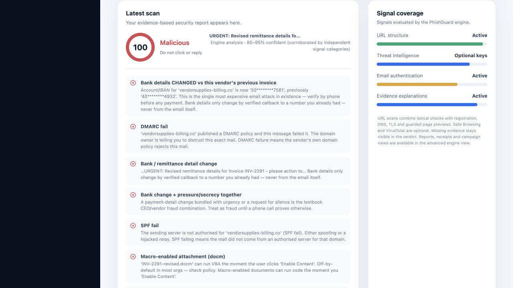
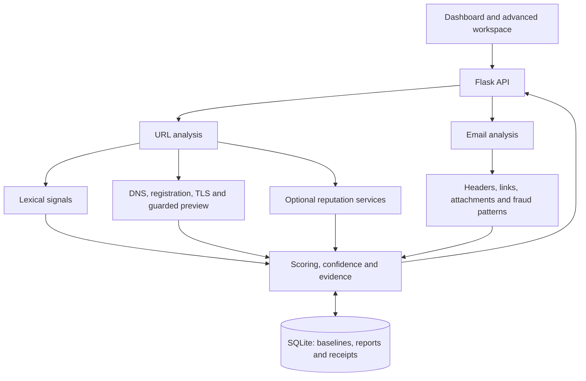

<div align="center">

# PhishGuard

### Explainable phishing detection for links, emails, and payment fraud

Understand the warning signs. Verify the evidence. Make a safer decision.

[](https://github.com/garvpahwa007/acm1/actions/runs/40068765263)


[Overview](#overview) · [Features](#key-features) · [Quick start](#quick-start) · [Demo](#demo-walkthrough) · [Architecture](#architecture) · [Validation](#validation)

</div>

---

## Overview

PhishGuard is a working web application that analyzes suspicious links and raw email messages, explains the evidence behind each verdict, and identifies fraud patterns across repeated reports.

Phishing is more than a suspicious URL. A convincing invoice can come from a familiar sender while redirecting payment to a different bank account. A link can change after delivery. A message can use urgency, secrecy, or a local scam story to discourage verification.

PhishGuard combines URL analysis, email forensics, organization history, and payment-detail comparisons in one workflow. Each verdict includes a risk score, named signals, confidence, and practical next steps. When verification is incomplete, the interface preserves that uncertainty.



*A sample invoice receives a malicious verdict with evidence for changed bank details, failed sender authentication, and a macro-enabled attachment.*

## Key features

| Capability | What it demonstrates |
| --- | --- |
| **Progressive URL analysis** | An initial lexical verdict followed by registration, DNS, TLS, optional reputation checks, and a guarded page preview. |
| **Email forensics** | Authentication headers, Reply-To mismatches, suspicious attachments, links, and social-engineering language. |
| **Bank-detail change detection** | Compares invoice payment identifiers with a stored vendor baseline and flags changes for independent verification. |
| **India-specific scam signals** | Rules for UPI collect requests, KYC-expiry lures, digital-arrest threats, and other locally relevant patterns. |
| **Organization history** | Tracks first-contact senders, domain sightings, and changes in previously scanned links. |
| **Campaign reporting** | Groups related reports and displays report counts and reported clicks in the organization sweep view. |
| **Verdict receipts** | Saves structured evidence that can be retrieved as JSON for review. |
| **Visible uncertainty** | Shows confidence, provisional results, and unavailable checks instead of presenting incomplete evidence as certainty. |

### Two interfaces, one engine

- **Dashboard — `/`:** streamlined link and email scanning, explainable findings, and browser scan history.
- **Advanced workspace — `/advanced`:** detailed analysis, campaign views, reporting, receipts, vendor account confirmation, coverage, and light/dark themes.

Both interfaces use the same Flask API and detection engine.

## Quick start

**Prerequisites:** Python 3.11 or 3.12 is recommended; both are covered by automated tests. An internet connection is needed to install dependencies and perform live infrastructure lookups.

```bash
git clone https://github.com/garvpahwa007/acm1.git
cd acm1
```

**macOS / Linux**

```bash
./run.sh
```

**Windows**

```bat
run.bat
```

The launcher creates an isolated environment, installs dependencies, seeds demo data when needed, runs the tests, and starts the application.

Open **[http://localhost:8000](http://localhost:8000)** for the dashboard or **[http://localhost:8000/advanced](http://localhost:8000/advanced)** for the advanced workspace. No npm installation or frontend build step is required.

<details>
<summary><strong>Manual Python setup</strong></summary>

```bash
python3 -m venv .venv
source .venv/bin/activate
# Windows activation: .venv\Scripts\activate
pip install -r backend/requirements.txt
python3 backend/scripts/seed_demo.py
python3 backend/app.py
```

The HTML is rendered by Flask. Start the backend to use the application; opening template files directly or using GitHub Pages alone does not run the backend.

</details>

<details>
<summary><strong>Docker setup</strong></summary>

```bash
docker compose up -d --build
```

The application is available on port `8000`. A named volume preserves SQLite state across container restarts.

</details>

## Demo walkthrough

Use the included examples to evaluate the application without uploading real mail.

1. **Detect invoice fraud.** Open the dashboard, select **Email / Headers**, and click **sample scan**. Inspect the changed bank details, authentication failures, attachment warning, and verdict receipt.
2. **Compare a clean control.** Open `/advanced`, select **Check an email**, and load the clean sample. Compare its evidence with the invoice example.
3. **Inspect a link.** Select **Check a link** in the advanced workspace and use a supplied example. Observe the initial lexical result followed by available infrastructure and reputation evidence.
4. **Explore campaign reports.** Open **Org sweep** to inspect the seeded campaigns and reported clicks.

The samples are illustrative scenarios, and the seeded organization data is for demonstration. Monetary protection figures are estimates derived from demo assumptions, rather than measured financial savings.

## Architecture



### Project structure

```text
acm1/
├── frontend/
│   ├── templates/          Dashboard and advanced workspace
│   └── static/             Separate JavaScript and CSS assets
├── backend/
│   ├── app.py              Flask routes and API entry point
│   ├── engine/             Detection, scoring, network checks and storage
│   ├── samples/            Attack examples and a clean control
│   ├── scripts/            Demo-data initialization
│   └── tests/              Engine and integration tests
├── Dockerfile
├── docker-compose.yml
├── run.sh
└── run.bat
```

### API highlights

| Method | Endpoint | Purpose |
| --- | --- | --- |
| `GET` | `/api/health` | Engine health and configured reputation services |
| `POST` | `/api/check/url?mode=quick` | Initial lexical URL analysis |
| `POST` | `/api/check/url?mode=full` | Full URL analysis |
| `POST` | `/api/check/email` | Analyze raw message text or an `.eml` upload |
| `POST` | `/api/report` | Record a campaign report |
| `GET` | `/api/clusters` | Retrieve campaign clusters |
| `GET` | `/api/receipt/<id>` | Retrieve a verdict receipt |
| `POST` | `/api/vendor/confirm` | Confirm a pending vendor account change after independent verification |

## Validation

**The completed validation run passed all 54 automated tests locally and in GitHub Actions on Python 3.11 and 3.12.** [View the test run](https://github.com/garvpahwa007/acm1/actions/runs/40068765263).

Coverage includes legitimate-domain controls, deceptive URL constructions, scoring behavior, sample email analysis, vendor-account comparisons, report clustering, SSRF safeguards, and integration between the interfaces and API. Browser checks also verified the sample-email workflow and advanced workspace.

```bash
pip install -r backend/requirements.txt pytest
python3 backend/scripts/seed_demo.py
python3 -m pytest backend/tests/ -q
```

Initialize demo state before running the suite. These checks validate implemented behavior; they are not a benchmark of real-world detection accuracy. Docker and Windows launchers are included; interactive validation was performed on macOS.

## Configuration and data

The application works without paid API keys. Safe Browsing and VirusTotal integrations are optional. See [`.env.example`](.env.example) for configuration names.

For direct Python runs, export environment variables in your shell; the server does not automatically load a `.env` file. Docker Compose reads a root `.env` file for its configured settings. Keep all service keys on the backend.

- SQLite stores vendor baselines, observations, campaign reports, and receipts.
- Scan history is also saved in the current browser until cleared.
- Uploaded messages are processed by the application server. Receipts can retain message-derived information, so evaluation should use the included samples.
- URL scans can make outbound infrastructure, reputation, and preview requests.

## Current scope and next steps

PhishGuard is a functional prototype for evaluation, with explainable rules and explicit handling of incomplete evidence. Current limits include raw `.eml`/text input, a small public-suffix knowledge base, and page previews that do not execute JavaScript. It does not decode QR codes or guarantee detection of every phishing attempt.

Before deployment to multiple users, planned work includes authentication, rate limits, tenant isolation, retention controls, stronger isolation for outbound previews, and evaluation against labeled phishing and legitimate-message datasets.

For detailed setup and troubleshooting, see [RUN-LOCAL.md](RUN-LOCAL.md).
