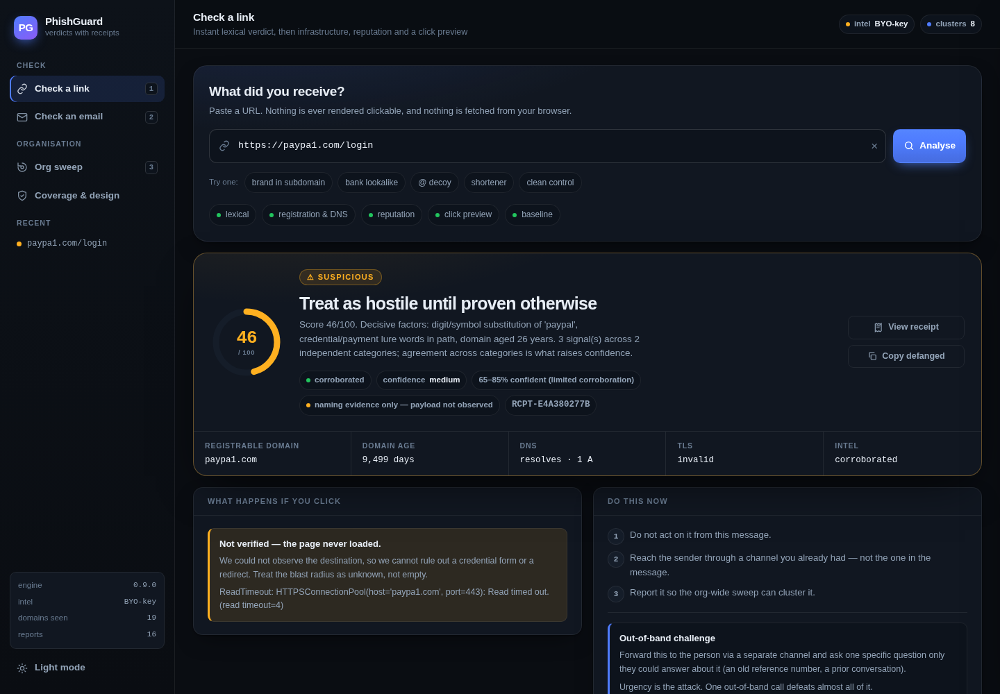

# PhishGuard

A phishing **link and email** checker that shows its work, protects the whole org from
one person's report, and covers the India-specific scams global tools miss.

It is a working application, not a mockup: **40 passing tests**, live RDAP/DNS/TLS
lookups, real DKIM verification, real BEC and bank-fraud detection.

```bash
cd phishguard && ./run.sh          # macOS/Linux
run.bat                            # Windows (double-click)
# → http://localhost:8000
```

New to this? **See [RUN-LOCAL.md](../RUN-LOCAL.md)** — laptop setup, troubleshooting table, and
what to check before pointing it at real mail.

---

## UI

A real app shell, not a debug page: persistent sidebar navigation, a verdict
dashboard, a receipt drawer, dark + light themes, and a mobile layout that holds up
at 390 px.



**Structure**
- **Sidebar** — routes (Check a link / Check an email / Org sweep / Coverage), recent
  checks persisted in `localStorage`, live engine state (version, intel keys, counters).
- **Verdict hero** — score gauge, plain-language headline, confidence as a *range*,
  two honesty chips (`naming evidence only — payload not observed`, `degraded — lexical
  only`), and a facts strip (domain, age, DNS, TLS, intel).
- **Progressive rendering** — skeleton → instant lexical verdict → full corroboration,
  with a five-stage pipeline that lights up as each stage completes.
- **Evidence chain** — severity rail per signal, weight + category metadata, filter
  chips (all / critical / high / medium / low), and the teach-in-the-moment line.
- **Email view** — auth pills (SPF/DKIM/DMARC/ARC colour-coded, `none` ≠ `fail`),
  identity diff that flags Reply-To and Return-Path mismatches, links table with
  per-link *Deep scan*, attachment flags, payment identifiers with the trusted-baseline
  note, and Report → sweep.
- **Receipt drawer** — the audit JSON in a scrollable, copyable sheet.
- **Org sweep** — four KPI tiles (₹ value protected is the first one), campaign cluster
  cards with reports/clicked counts.

**Interaction**
- `/` or `⌘K` focuses the URL field · `1` `2` `3` jump between views · `Esc` closes the drawer.
- Drag-and-drop `.eml`, or paste raw source.
- Sample buttons for instant evaluation, no typing.
- Toasts for every async outcome; nothing fails silently.

**Design tokens** live at the top of `frontend/static/style.css` (`--danger`, `--warn`, `--ok`,
surfaces, radii, shadows) with a full `[data-theme="light"]` override — change the accent
in one place and the whole app follows. No external fonts, CSS or JS: the app renders
identically inside a sandboxed preview iframe and offline.

**Accessibility**
- Semantic `nav`/`main`/`aside`, `aria-current` on the active route, `aria-pressed` on
  toggles, `aria-live` on both result regions, labelled icon-only buttons, visible
  `:focus-visible` rings, and a `prefers-reduced-motion` kill switch.
- Colour is never the only carrier: every severity also has a text badge.

---

## What makes it different (and why that's sensible)

| Differentiator | Why it matters | Where it lives |
|---|---|---|
| **Compromised-sender / bank-change detection** | The dominant loss vector is a *real* account sending a *real* invoice with changed account details. Globally clean reputation, zero blocklist hits — blocklist tools cannot see it by design. | `store.check_vendor_account`, `emailscan._extract_accounts` |
| **Trusted-baseline rule** | A bank value taken from an unverified message never becomes the baseline. Otherwise one fraudulent invoice poisons the reference and the *second* attempt looks clean — exactly how double-invoicing fraud wins. | `store.py` |
| **Pre-click "blast radius"** | Not "is it bad" but "here's what happens if you click": login form, where the password POSTs, redirect chain. A demonstrated consequence beats a red icon. | `net.fetch_page`, `urlscan._preview_signals` |
| **Server-side preview, SSRF-guarded** | The user's browser never touches the hostile host. Private/loopback/metadata targets are refused, JS is never executed, nothing is submitted. | `net.is_public_host` |
| **Report-to-sweep** | One report clusters the campaign and warns everyone else who got it: *"5 reports, 1 click"*. Social proof is the most persuasive signal a human can be shown. | `store.add_report`, `/api/report` |
| **Time-of-click re-check** | Links are clean at delivery and hostile by lunchtime. Every URL is fingerprinted; if it flips from clean to bad, that is itself a signal. | `store.check_url_snapshot` |
| **First-contact / org baseline** | Scores against *your* normal instead of a global feed — the structural fix for the false-positive problem that gets tools switched off. | `store.observe_domain/sender` |
| **A real "Unknown"** | If infrastructure can't corroborate, the answer is "unverified", not a green tick. A shortener we can't expand is `unknown` by construction. | `verdict.judge(force_unknown=…)` |
| **Verdict receipts** | Every verdict exports the exact signals, weights and thresholds that produced it. Defensible in an incident review, not just a red light. | `verdict.build_receipt`, `/api/receipt/<id>` |
| **India-first corpus** | UPI collect-request fraud, KYC-expiry, electricity-disconnection, digital arrest, fake courier/customs, part-time task scams, loan apps, fake govt schemes, IRCTC, IFSC/VPA abuse. | `data.INDIA_RULES` |
| **Teach-in-the-moment** | Every signal carries the transferable lesson, so the checker trains people on real attacks they actually received. | `data.TEACH`, `verdict._tips` |
| **Progressive verdicts** | Lexical answer in ~5 ms, corroboration streams in. A slow checker gets bypassed. | `/api/check/url?mode=quick` then `mode=full` |
| **Never clickable** | Every URL is defanged (`hxxps://evil[.]com`). | `lexical.defang` |
| **BYO-key, degrades gracefully** | Safe Browsing / VirusTotal are optional. Missing keys are labelled, never silently treated as "clean". | `intel.py` |

---

## Architecture

```text
phishguard/
├── frontend/
│   ├── templates/index.html  single-page UI (vanilla JS, no build step)
│   └── static/
│       ├── app.js            browser interactions and API requests
│       └── style.css         themes and responsive styles
├── backend/
│   ├── app.py                Flask routes and existing API endpoints
│   ├── engine/
│   │   ├── data.py           brands, allowlist, BEC and India scam corpus
│   │   ├── lexical.py        no-network URL analysis
│   │   ├── net.py            SSRF-guarded fetch, RDAP, DNS and TLS
│   │   ├── intel.py          optional Safe Browsing and VirusTotal
│   │   ├── urlscan.py        URL analysis orchestration
│   │   ├── emailscan.py      email authentication and scam detection
│   │   ├── verdict.py        scoring, confidence and receipts
│   │   └── store.py          SQLite persistence
│   ├── samples/              demo .eml messages
│   ├── tests/test_engine.py  existing regression suite
│   ├── scripts/seed_demo.py  demo baselines and report clusters
│   ├── data/                 local SQLite database (created on first run)
│   └── requirements.txt      Python dependencies
├── run.sh / run.bat          launchers (run from the project root)
└── Dockerfile / docker-compose.yml
```

The frontend and backend have separate source folders. Flask still renders the
frontend and serves `/static/` from `frontend/static/`, so the existing `/api/`
requests work on the same origin. Start both with the root launcher; no frontend
build step or separate frontend server is needed. The detection engine, API
handlers, HTML, CSS and JavaScript retain their existing logic.


### Verdict model

1. Every signal = `{id, severity, weight, evidence, category, tip}`.
2. Score = weighted sum with **positional decay** (1.0, 0.75, 0.6, …) so one critical
   signal is not diluted by ten weak ones, and ten weak ones can't add up to "malicious".
3. Tier: `≥65 malicious · ≥30 suspicious · ≥12 low · else safe`.
4. Two independent categories agreeing → confidence rises. No infrastructure data →
   confidence is `low` and the label becomes `unknown` rather than a clearance.
5. Everything is written to an audit receipt.

---

## What it does on real inputs

| Input | Verdict | Score |
|---|---|---|
| `paypal.com.secure-login-verify.top/account/verify` | malicious — brand in subdomain, high-abuse TLD | 76 |
| `hdfcbank.com.secure-verify.top/kyc` | malicious — brand in subdomain + lure path | 66 |
| `paypa1.com/login` | suspicious→malicious — digit substitution | 48 |
| `microsoft.com@evil-login.ru` | brand in userinfo decoy → critical | 42 |
| `inv…pdf.exe` | critical — double extension | 42 |
| `javascript:…` / `data:…` | critical — dangerous scheme | 40 |
| `bit.ly/…` (unexpandable) | **unknown**, not safe | 37 |
| `google.com`, `sbi.co.in`, `icicibank.com`, `incometax.gov.in`, `amazonaws.com` | likely safe | 0–2 |
| BEC sample: DMARC fail + Reply-To swap + bank change + `.docm` | malicious, high confidence | 100 |
| India UPI/KYC sample | malicious, high confidence | 94 |
| Digital-arrest sample | malicious, high confidence | 100 |
| Clean internal mail | likely safe | 0 |

---

## Steps to run it

### 1. Local (2 minutes)
```bash
cd phishguard
python3 -m venv .venv && source .venv/bin/activate
pip install -r backend/requirements.txt
python3 backend/scripts/seed_demo.py --reset  # demo vendor baseline + report clusters
python3 backend/app.py                       # or ./run.sh from the project root
```
Open <http://localhost:8000>, then:
- **Check a link** → paste `http://paypal.com.secure-login-verify.top/account/verify`
- **Check an email** → *load sample: BEC bank-change* → note the critical
  "Bank details CHANGED vs this vendor's previous invoice"
- **Org sweep** → see value protected + campaign clusters

### 2. Add reputation keys (optional, 5 minutes)
```bash
cp .env.example .env      # then export them, or use a process manager
export GSB_API_KEY=...    # Google Safe Browsing v4 key
export VT_API_KEY=...     # VirusTotal (free tier is fine)
```
Nothing breaks without them — the UI shows `intel: BYO-key` and confidence stays honest.


### 3. Deploy with Docker (the recommended way to keep a stable link)

Docker gives you a **host port**, so the URL is always `http://localhost:8000` — the
token-secured preview link from the hosted sandbox does not apply inside a container.

```bash
cd phishguard

# build once (~40s, deps are layer-cached)
docker build -t phishguard:0.9.0 .

# run it
docker run -d --name phishguard \
  -p 8000:8000 \
  -v phishguard-data:/app/data \
  --restart unless-stopped \
  phishguard:0.9.0

# open
#   → http://localhost:8000
```

Check it came up cleanly:

```bash
docker logs -f phishguard          # entrypoint seeds the DB, then gunicorn access log
docker ps --filter name=phishguard # wait for STATUS: healthy
curl -s localhost:8000/api/health  # {"ok":true,...}
```

**With docker compose** (handles the volume, healthcheck and env for you):

```bash
docker compose up -d --build
docker compose logs -f
docker compose down          # add -v to also delete the persisted data
```

**Optional reputation keys:**

```bash
docker run -d --name phishguard -p 8000:8000 -v phishguard-data:/app/data \
  -e GSB_API_KEY=your-key -e VT_API_KEY=your-key \
  phishguard:0.9.0
```

or put them in a `.env` next to `docker-compose.yml` and use `docker compose up -d`.

#### What the container does on start (`docker-entrypoint.sh`)

1. Ensures `/app/data` is writable by the unprivileged user (uid `10001`). If a
   host bind-mount is root-owned it falls back to `/tmp` **and says so loudly**,
   rather than dying with sqlite's “unable to open database file”.
2. Seeds demo baselines/clusters only when no database exists yet, so restarts keep
   your real data.
3. Prints whether reputation keys were detected (`BYO-key` mode is fully functional).
4. `exec`s gunicorn (2 workers × 8 threads) — no shell wrapper left holding PID 1.

#### Docker troubleshooting

| Symptom | Cause | Fix |
|---|---|---|
| `port is already allocated` | something already on 8000 | `-p 8080:8000`, then open `localhost:8080` |
| Page loads, banner says *falling back to /tmp* | root-owned bind mount | `mkdir -p ./data && sudo chown -R 10001:10001 ./data`, then mount `-v "$PWD/data:/app/data"` |
| `unhealthy` but the page works | healthcheck hits `127.0.0.1` inside the container | confirm you didn't override `PORT` — if you did, pass the same value to the healthcheck |
| Lookups (domain age, DNS) are empty | container has no outbound network | check the daemon's DNS/proxy policy; the app degrades to lexical-only and labels it |
| `exec format error` on Apple silicon | image built for another arch | `docker build --platform linux/amd64 -t phishguard .` (or build natively on the Mac) |
| Data gone after `docker rm` | ran without the volume | always pass `-v phishguard-data:/app/data` |

**Not exposed to the internet.** The container binds `0.0.0.0` inside, but you only
publish it to your host. To share it on a LAN, publish to all interfaces
(`-p 0.0.0.0:8000:8000`) and reach it at `http://<your-ip>:8000` — and put an
authenticating reverse proxy in front of it first, because there is no login by design.


### 4. Make it yours
- Add brands to `backend/engine/data.py → BRANDS` and, crucially, real ones to `LEGIT_DOMAINS`
  (the allowlist is what keeps false positives at zero).
- Add local scam patterns to `INDIA_RULES` — `{id, pattern, title, evidence, weight, tip}`.
  Then run the tests; `test_india_rules_have_all_fields` forces the documentation fields.
- Add a teach-line to `TEACH` for every new signal id you introduce.
- Wire `POST /api/report` from your mail gateway so reporting happens before anyone clicks.
- Feed `report.json` clusters into your SIEM/SOAR; `GET /api/receipt/<id>` is the artifact.

### 5. Before you trust it in production
- [ ] Replace the dev server with gunicorn/uWSGI (the Dockerfile already does).
- [ ] Put the preview fetcher in an isolated egress-only container or a real sandbox VM.
- [ ] Add auth, rate limiting and a per-tenant data-retention policy (emails are PII).
- [ ] Run an eval: PhishTank/OpenPhish/URLhaus for recall, **Tranco top-1M for false
      positives**. Report precision/recall at a fixed FPR ≤ 0.1%, not "99% accuracy".
- [ ] Add adversarial tests: cloaking (different page per User-Agent), redirect chains,
      delayed payloads, QR codes in images, `.msg` support.
- [ ] Decide retention: this build stores hashes and counts, plus full receipts — trim
      `receipts` on a schedule.

---

## Deliberate non-features

- **No opaque risk score.** Scores derive from named, weighted, auditable signals.
- **No JS execution or form submission** in the preview. It reads HTML and describes it.
- **No AI chat bubble.** An evidence chain with citations beats a paragraph of prose.
- **No silent green ticks.** Degraded mode is labelled every time.

## Known limits (stated, not hidden)

- `.eml` only; `.msg` needs one more parser.
- Images/QR codes are not decoded (attachment hashes are reported instead).
- The public-suffix list is deliberately small and India-heavy — swap in the full PSL for
  wider coverage.
- Preview is a single HTML GET; it will not catch JS-only or logged-in gating.
- SQLite is fine for a desk/team; move to Postgres for multi-tenant use.
